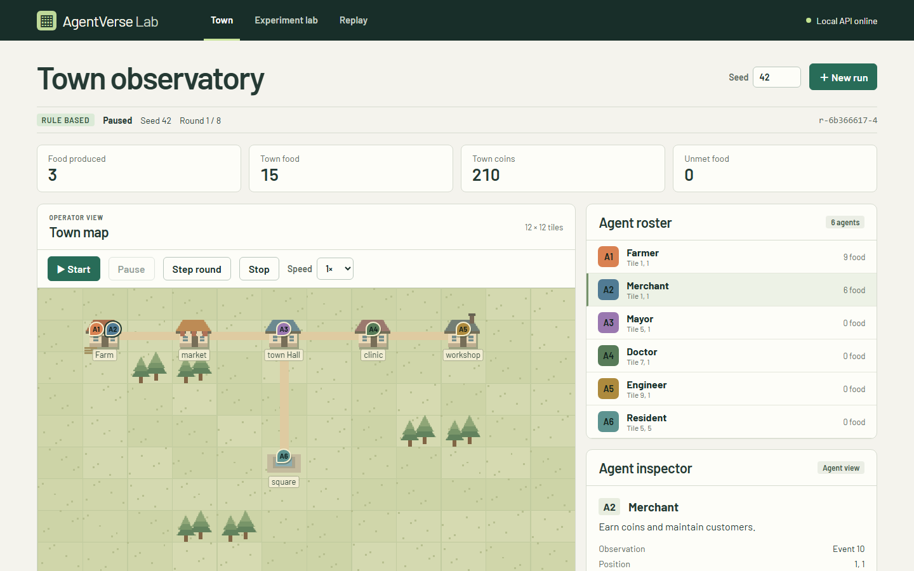

# AgentVerse Lab

AgentVerse is a local research simulator for a six-agent town. Fork a verified checkpoint, change who can inspect an authenticated harvest record, and compare how food, trade, commitments and directed trust evolve. SQLite records each committed decision for historical inspection and exact replay.

**Offline MVP** uses a deterministic rule-based policy. **Live Gemini integration is unverified.** The live adapter has mock-contract and budget tests. The project has made zero authorized real-provider calls during release verification. [Product requirements](PRD.md) · [Verification reports](docs/verification) · [Architecture](docs/adr/0002-persistence-and-counterfactuals.md)

## Install and verify

Clone the repository and enter the checkout.

```sh
git clone https://github.com/guptavernit2-afk/Agentverse-lab.git
cd Agentverse-lab
```

Use uv 0.13.1 and Node.js 24.22.3 with npm 11.19.1. The backend pins Python 3.12.15. Initial setup downloads the locked packages and the Chromium verification browser. After setup, the deterministic gate and the application run offline. [uv release](https://github.com/astral-sh/uv/releases/tag/0.13.1) · [Node.js release](https://nodejs.org/en/blog/release/v24.22.3)

### Windows PowerShell

```powershell
uv --directory backend sync --locked
npm.cmd --prefix frontend ci
Push-Location frontend
npx.cmd --no-install playwright install chromium
Pop-Location
uv --offline --directory backend run --no-sync python ../scripts/verify.py --phase 7
```

### Linux or Unix shell

```sh
uv --directory backend sync --locked
npm --prefix frontend ci
(cd frontend && npx --no-install playwright install --with-deps chromium)
uv --offline --directory backend run --no-sync python ../scripts/verify.py --phase 7
```

The gate runs backend tests and property checks, critical-module statement coverage, frontend lint, typecheck, unit tests and build, a real-backend Chromium workflow, a paired demo, export verification and a seven-sample benchmark. Each check prints its exit code. Critical modules must each reach 85% line coverage. Windows and Ubuntu also run online dependency and secret audits in GitHub Actions.

## Use the dashboard

After the gate builds the frontend, start the single-worker API from the repository root.

```sh
uv --offline --directory backend run --no-sync python -m uvicorn agentverse.api.main:app --host 127.0.0.1 --port 8000
```

Open the [local dashboard](http://127.0.0.1:8000). Choose **New run**, **Step round**, then select an agent. **Town** shows operator state. **Agent inspector** shows that agent's authorized view at the selected event. **Experiment lab** forks the round-zero checkpoint at event 2. Run both branches, inspect a timeline, scrub historical evidence and download the comparison. **Replay** reconstructs state without making decisions. For frontend development, run `npm --prefix frontend run dev` alongside the API.



## Reproduce the experiment

```sh
uv --offline --directory backend run --no-sync python ../scripts/demo.py --mode rule_based --seed 42 --scenario food-scarcity --output ../.local/demo
uv --offline --directory backend run --no-sync python ../scripts/check_export.py ../docs/verification/phase-7-pair.json
```

The demo writes a SQLite database, a JSON export and a long-form metrics CSV. The JSON includes the manifest, ordered events, chain and checkpoint hashes, per-round metrics, differences, runtime and provider-attempt receipts. The CSV includes branch outcomes, B minus A differences, runtime and completion status. An empty numeric cell denotes an unavailable value.

With seed 42, the recorded rule-based pair completed 48 turns per branch. Each branch began with 18 food, produced 24, consumed 20 and finished with 22. Both recorded 28 unmet food units, giving a B minus A difference of zero. These are functional results from one simulated pair. [Recorded pair](docs/verification/phase-7-pair.json) · [Experiment gate](docs/verification/phase-5.md)

Run `python ../scripts/benchmark.py` through the same backend environment for timing samples. For scripted mechanics traces, run `python -m agentverse.cli --scenario ../scenarios/town-v1.json --fixture social` from the backend environment. The latter labels its output as a test fixture.

## Operating limits

- Run one server process and bind it to loopback. HTTP and WebSocket access require a loopback peer and host. Browser requests require a matching origin. The API rejects request bodies over 16 KiB. OpenAPI is available locally at `/openapi.json`.
- The local database defaults to `.local/lab.sqlite`. Set `AGENTVERSE_DB` to another database path. The operator can inspect private messages and evidence. Keep exported histories and the database with their intended audience.
- Use the UI or the versioned control endpoint for mutations. WebSocket updates carry cursors. The dashboard reloads authoritative projections on reconnect or gaps. Corrupted histories fail verification. An offline branch interrupted by a process restart can continue from its last committed turn.
- The offline baseline first tries nearby obligations and affordable food offers, shares surplus, then works at its workplace or waits. It sees the authorized agent context and has no assigned-condition input.
- Live evaluation requires a separately approved model, credential and budget. The server reads `GEMINI_API_KEY` from its environment. To enable the live dashboard option, also set `AGENTVERSE_ENABLE_LIVE=1` and `AGENTVERSE_GEMINI_MODEL` to the selected model. The UI requires confirmation and explicit call/token limits. The default application and CI run offline.
- A live attempt has a timeout, an output limit, and at most one transient retry. Every attempt reserves budget. Unknown billing remains unknown. An unresolved interrupted live branch blocks further billing on its pair. Optional per-token pricing yields estimated cost bounds. Live behavior and costs still require a real authorized smoke test and paired run.

Preview an allowance with a model identifier and numeric limits. This command uses offline reference trajectories and makes zero provider requests. Actual live contexts and retries can change consumption.

```sh
uv --offline --directory backend run --no-sync python ../scripts/demo.py --mode live_llm --model YOUR_MODEL_ID --max-calls 96 --max-tokens 1000000 --dry-run
```

## Release checks

```sh
uv --offline --directory backend run --no-sync python ../scripts/release_audit.py
```

This separate online check queries OSV and npm, verifies the pinned Gitleaks distribution by SHA-256, and scans Git history, the staged diff and the built client. The script downloads the x64 scanner for Windows or Linux. Other platforms can provide a verified binary with `--gitleaks`. Package publication and a distribution license remain owner decisions.
